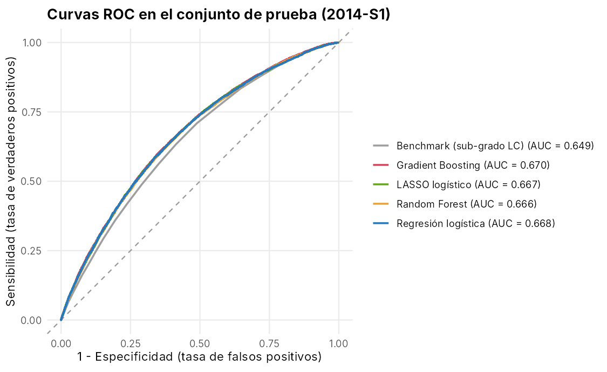
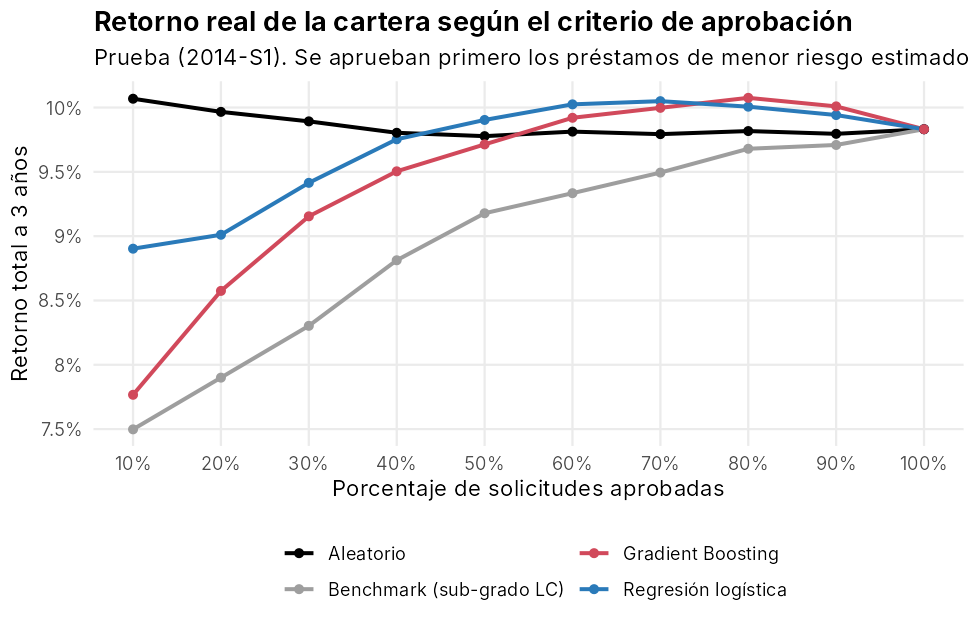
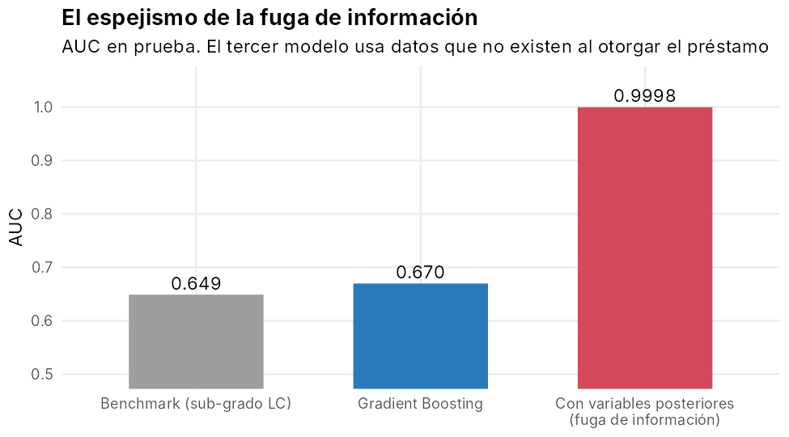
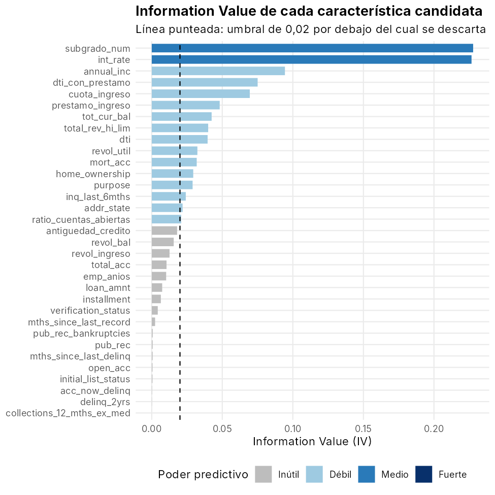
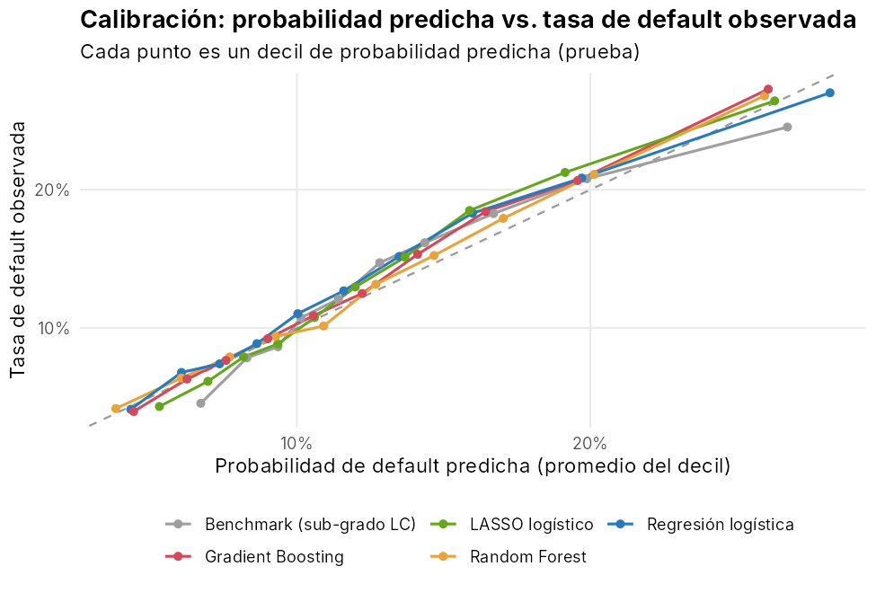

# Who won't pay back the loan?
### Credit default prediction on 215,845 real LendingClub loans — out-of-time validation, leakage-free pipeline and dollar-value evaluation (R)

**Matías Costabile** · Data Science, Universidad Católica Argentina (UCA)
📄 **Full report (Spanish, LaTeX/arXiv style): [`report/informe.pdf`](report/informe.pdf)**

---

## TL;DR

| | |
|---|---|
| **Data** | 215,845 real 36-month loans issued by LendingClub (2012 – mid 2014), all with a final outcome. 12.9% defaulted. US$2.69 B lent. |
| **Question** | Using *only* what is known on the application day, can we predict default better than LendingClub's own grade — and is it worth money? |
| **Validation** | **Out-of-time**: train on 2012–2013, test once on 2014. Hyperparameters and decision threshold chosen on a later validation period (2013-H2). |
| **Best model** | Gradient Boosting — **AUC 0.670** (Gini 0.339) vs **0.649** for LendingClub's sub-grade (DeLong p ≈ 10⁻³⁵). |
| **In dollars** | Approving the same 70% of applications, the model's portfolio defaults **9.4% vs 10.1%** and returns **10.00% vs 9.49%** → **+US$4.3 M** on the test portfolio. |
| **Biggest lesson** | Adding variables only known *after* the loan is granted inflates AUC to **0.9998**. Near-perfect LendingClub results in the literature should be read with caution. |

<p align="center">
  
</p>

## Key findings

**1. Every model beats the platform's own grade.** The difference is small (+0.02 AUC) but statistically significant and stable between validation (2013-H2) and test (2014-H1).

**2. Algorithm complexity barely matters.** Logistic regression (AUC 0.668) is within 0.002 of Gradient Boosting. In tabular credit data, most of the gain comes from the features, not from the algorithm. This matches the literature (Namvar et al. 2018; Turiel & Aste 2020; Lessmann et al. 2015).

**3. Feature engineering paid off.** Two engineered variables — *DTI including the new loan's installment* and *installment-to-income* — ranked among the 4 most important predictors and replaced their raw counterparts.

**4. Minimizing defaults ≠ maximizing profit.** Approving only the safest 10% by sub-grade earns **7.5%**, *less than approving at random* (10.1%), because the safest borrowers pay the lowest rates. A default model is not a profit model.

<p align="center">
  
</p>

**5. The data-leakage mirage.** A model that "knows" how much principal was repaid gets AUC 0.9998, and it is useless on application day. With origination data, ~0.70 AUC is the realistic ceiling.

<p align="center">
  
</p>

## Results on the test set (71,953 loans, 2014-H1)

| Model | AUC [95% CI] | Gini | KS | Brier | Sensitivity | Specificity | F1 |
|---|---|---|---|---|---|---|---|
| Benchmark (LendingClub sub-grade only) | 0.649 [0.643–0.655] | 0.298 | 0.220 | 0.1114 | 0.633 | 0.586 | 0.291 |
| Logistic regression | 0.668 [0.662–0.673] | 0.335 | 0.249 | 0.1102 | 0.657 | 0.590 | 0.302 |
| LASSO logistic | 0.667 [0.662–0.673] | 0.335 | 0.249 | 0.1102 | 0.619 | 0.629 | 0.305 |
| Random Forest | 0.666 [0.661–0.672] | 0.333 | 0.248 | 0.1101 | 0.696 | 0.548 | 0.299 |
| **Gradient Boosting** | **0.670 [0.664–0.675]** | **0.339** | **0.251** | **0.1100** | 0.684 | 0.565 | 0.302 |

Threshold-dependent metrics use the Youden-optimal threshold chosen on validation, never on test.

## Methodology

```
Raw LendingClub data (146 columns)
   │  keep 36-month loans, 2012-01 → 2014-06, final status only
   ▼
215,845 loans  ──  30 origination vars  |  5 post-origination vars (evaluation only, never features)
   │
   ├─ (A) Extraction      credit-history length, sub-grade → 1..35, installment/income, DTI incl. new loan …
   ├─ (B) Transformation  winsorizing (p1/p99), log1p, rare-level grouping, WoE encoding, standardization
   ├─ (C) Imputation      structural ("never delinquent") vs. median, plus missing-value indicators
   └─ (D) Selection       Information Value ≥ 0.02 → correlation filter |r| > 0.85 → LASSO
   │      (every parameter is learned on the fit period only)
   ▼
Models: Benchmark · Logistic · LASSO · Random Forest · Gradient Boosting
   │      tuned on 2013-H2, refit on 2012–2013, tested ONCE on 2014-H1
   ▼
AUC (DeLong CI & test) · Gini · KS · Brier · confusion matrix · calibration · importance · $ return
```

<p align="center">
  
  
</p>

## How to run

1. Install [R](https://cran.r-project.org/) (≥ 4.1) and [RStudio](https://posit.co/download/rstudio-desktop/).
2. Clone the repo and open **`LendingClub_RiesgoCredito.Rproj`**.
3. Open **`main.R`** and click **Source**. Missing packages (`ggplot2`, `pROC`, `glmnet`, `ranger`, `gbm`) install automatically.

Runtime is about 5–15 minutes. Results are fully reproducible (fixed seed). Every number in the PDF report is read from `results/numeros.tex`, which the code writes, so the report never goes out of sync with the code.

To rebuild the report: `cd report && latexmk -pdf informe.tex`

## Repository structure

```
├── main.R                         # entry point: runs the whole pipeline
├── R/
│   ├── utils.R                    # helpers (WoE/IV, KS, metrics, thresholds) with pre/postconditions
│   ├── 01_preparacion.R           # load, validate, target, out-of-time split
│   ├── 02_exploracion.R           # EDA plots
│   ├── 03_features.R              # extraction, transformation, imputation, selection
│   ├── 04_modelos.R               # 5 models + leakage experiment
│   └── 05_evaluacion.R            # metrics, ROC, confusion, calibration, economics
├── data/lending_club_36m_2012_2014.csv
├── scripts/00_construir_dataset.R # how the CSV was built from the raw LendingClub files
├── figures/                       # all plots (PDF + PNG)
├── results/                       # metrics tables (CSV + LaTeX) and numbers for the report
└── report/                        # LaTeX source (arXiv template) + informe.pdf
```

All code comments are in Spanish. Every function documents and checks its **preconditions, postconditions and invariants** with `stopifnot()`.

## Limitations & next steps

- **Reject inference:** only *approved* loans are observed, so the model can't be applied as-is to all applicants.
- This data version has **no FICO score**, which is a known strong predictor.
- The economic analysis is gross (no platform fees or funding cost).
- Next: profit-based / cost-sensitive models, survival models (when default happens), XGBoost/LightGBM with FICO, SHAP explanations and fairness checks.

## Data source & license

Public LendingClub issued-loan data, as packaged in [kuhnrl30/LendingClubData](https://github.com/kuhnrl30/LendingClubData). The CSV here is a filtered subset; see `scripts/00_construir_dataset.R`.

---

### 🇦🇷 Resumen en español

Modelo de riesgo crediticio sobre 215.845 préstamos reales de LendingClub, con validación fuera de tiempo (entrena 2012–2013, prueba 2014). El mejor modelo (Gradient Boosting, AUC 0,670) supera a la calificación de la propia plataforma (AUC 0,649). Con el mismo 70% de aprobación, arma una cartera con menos defaults (9,4% vs 10,1%) y más retorno (10,00% vs 9,49%). El experimento de fuga de información muestra que usar datos posteriores al otorgamiento da un AUC engañoso de 0,9998. El informe completo en LaTeX (formato arXiv) está en [`report/informe.pdf`](report/informe.pdf).
